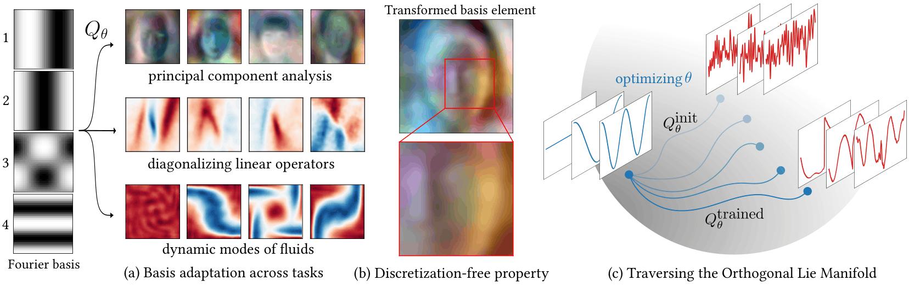

# Bases4Spaces: Neural Architecture for Rotation in Function Space



> **Official lean implementation** of [*Learning Orthonormal Bases for Function Spaces*](https://arxiv.org/abs/2605.19959)
> (NeurIPS 2026), provided by the authors of the paper. This branch is a refactored version of the
> code, optimized for understandability, and it omits some experiments. For full reproducibility of
> the paper's results, use the
> [`full-reproducibility` branch](https://github.com/HamidrezaKmK/Learning-ONBs/tree/full-reproducibility),
> which has the complete setup, including the NTK experiments.

Given a dictionary $\lbrace \phi_1, \phi_2, \ldots \rbrace$ on a domain $\Omega$ with Gram matrix

$$
G_{ij} = \langle \phi_i, \phi_j \rangle = \int_{\Omega} \phi_i(x) \phi_j(x) dx,
$$

this code learns a change of basis that preserves $G$. It adapts a generic basis (Fourier, Haar,
Voronoi) to a distribution of signals without changing the geometry of the function space.

A linear synthesis $\varphi_i = \sum_j Q_{ij} \phi_j$ with $QGQ^\top = G$ only works for finite
dictionaries. The paper instead flows the dictionary under a learned finite-rank skew-adjoint
generator $K_\theta$,

$$
\frac{d}{dt}(Q(t) \phi_i)(x) = (K_\theta(t) \phi_i)(x),
$$

integrated with Cayley steps so that inner products are preserved exactly
([`EulerianIsometry`](./infidictionary/neural_isometries/eulerian.py)). We combine the two: an
optional learned orthogonal synthesis fits the global structure quickly, and the flow refines the
details (see the [1-D FPCA notebook](./notebooks/fpca_1d.ipynb)).

The main application is **functional PCA**: jointly learn a mean function and an isometry that
maximizes the energy captured by the transformed dictionary, for stochastic processes, images and
collections of INRs, without fixing a discretization. The
[Eulerian transform tutorial](notebooks/eulerian_transform.ipynb) shows the transform on its own.

## Setup

```bash
conda env create -f environment.yml
conda activate infidictionary
```

The 1-D experiments generate their data and CelebA downloads itself. The INR experiments need
data in `data/`:

- **MNIST INRs:** `mnist-inrs.zip` is only available inside the 31.6 GB
  [DWSNets Dropbox bundle](https://www.dropbox.com/sh/56pakaxe58z29mq/AABtWNkRYroLYe_cE3c90DXVa?dl=0).
  Extract that member, then run `unzip mnist-inrs.zip -d data/`.
- **CIFAR-10 INRs:** download `archive.zip` from the
  [CIFAR10-INRS Kaggle dataset](https://www.kaggle.com/datasets/alexanderqi/cifar10-inrs-dataset)
  (no Kaggle account needed via `kagglehub.dataset_download("alexanderqi/cifar10-inrs-dataset")`)
  and run `unzip archive.zip -d data/` (creates `data/cifar_inrs_dataset/`).

## Training

```bash
python fpca.py +fpca_experiment=1d_fpca            # also 1d_fpca_haar, 1d_fpca_voronoi
python fpca.py +fpca_experiment=celeba_eulerian
python fpca.py +fpca_experiment=dwsnets_mnist_eulerian
python fpca.py +fpca_experiment=implicit_zoo_cifar_eulerian
```

Configs are composed with Hydra; append `key=value` to override (e.g. `seed=1`, `wandb=enabled`).
Checkpoints (`step_*.pt`) and the resolved `config.yaml` go to `outputs/checkpoints/<run>/`.

## Notebooks

| Notebook | Shows | Checkpoint |
|---|---|---|
| [`eulerian_transform`](notebooks/eulerian_transform.ipynb) | the transform and its Gram preservation | none |
| [`fpca_1d`](notebooks/fpca_1d.ipynb) | learned principal functions, reconstructions, PCA baseline | `1d_fpca*` |
| [`fpca_celeba`](notebooks/fpca_celeba.ipynb) | transformed atoms, mean face, reconstructions | `celeba_eulerian` |
| [`inr_fpca`](notebooks/inr_fpca.ipynb) | the same for MNIST / CIFAR-10 INRs | `dwsnets_mnist_eulerian`, `implicit_zoo_cifar_eulerian` |

By default each notebook downloads our trained checkpoint. To analyze your own run, set
`CHECKPOINT_DIR` and `CHECKPOINT_FILE` in its first cell.

## Pretrained checkpoints

Our trained checkpoints are on Hugging Face at
[`Shengdebao/Learning-ONBs`](https://huggingface.co/Shengdebao/Learning-ONBs), one folder per
experiment. The notebooks download the matching one automatically, so you can see the results
without training.

## Tests

`pytest` runs the unit tests and a smoke test that trains each 1-D experiment briefly. The
notebooks are not tested.

## Citation

```bibtex
@inproceedings{kamkari2026learning,
  title={Learning Orthonormal Bases for Function Spaces},
  author={Kamkari, Hamidreza and Nabizadeh, Mohammad Sina and Solomon, Justin},
  booktitle={Advances in Neural Information Processing Systems (NeurIPS)},
  year={2026},
  eprint={2605.19959},
  archivePrefix={arXiv},
  primaryClass={cs.LG},
  url={https://arxiv.org/abs/2605.19959}
}
```
